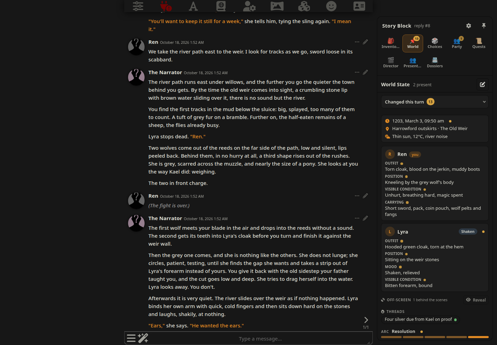
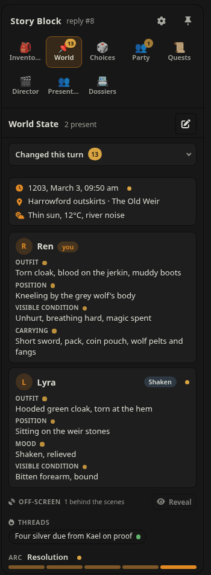
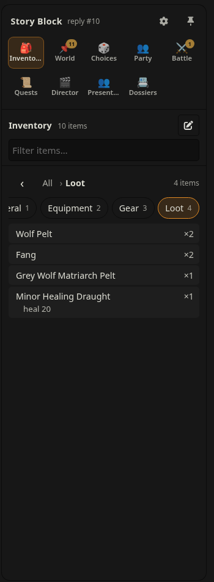
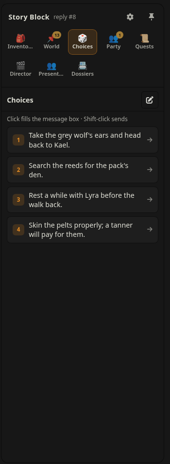
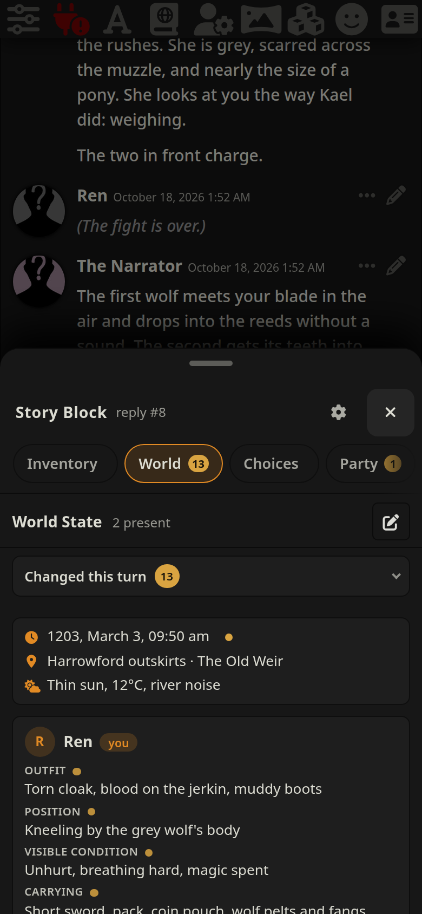
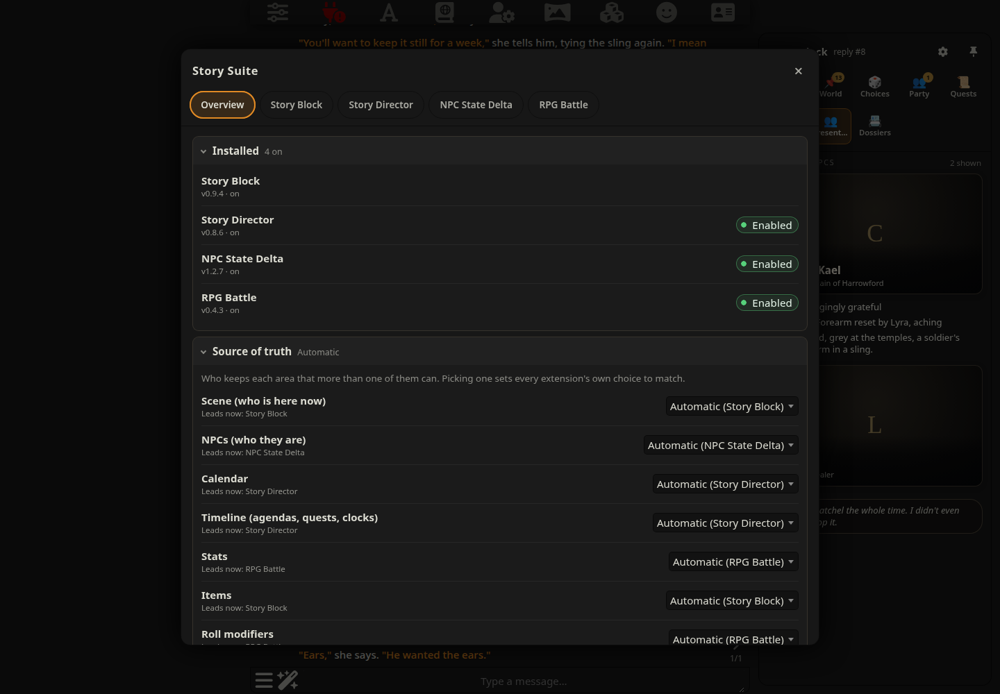

# Story Block v0.9.22

A SillyTavern extension that keeps story trackers — an inventory, a character sheet, scene
notes, or any block you design — inside the chat itself, injects their current state into
every reply's prompt, and draws them as one tabbed card under the latest reply.

Every block is a definition you can edit. The built-ins are only templates.



## What it does

- **One engine, any block.** Inventory, World State, Choices, Dice, NPC Inner Chatter,
  Character Sheet and Scene Notes ship as templates.
  Add your own blocks with their own tag, prompt, format and display, or change the
  templates; **Reset to default** brings a template back. A first install copies every
  template; after that the list is yours, so a template a later version adds is offered once
  at the top of **Blocks**: *New built-in blocks: 💭 NPC Inner Chatter — Add · Dismiss*.
  **Add** puts it in your list switched off (nothing changes until you turn it on);
  **Dismiss** hides it. Either way it is not offered again, even if you delete it later, and
  it is always under **Add block**. A built-in you deleted yourself is offered once the same way.
- **State that sticks.** A *stateful* block's newest valid copy in the chat is its current
  state. It is sent with every reply's prompt and the model rewrites it in full, so it can't
  scroll out of context. A reply that leaves it out, cuts it off or writes it badly never
  replaces the last good state.
- **Per-turn blocks** describe the latest reply only and are never fed back.
- **A sidebar for your blocks.** Docked beside the chat on wide screens, a drawer on tablets
  and narrow desktops, a bottom sheet on phones. Each block gets a tab with a badge counting
  what the latest reply changed, and structured blocks list those changes. Other extensions
  can add tabs. Prefer the old layout? Switch to a card under the latest reply.
- **Optional "This turn" strip** under the latest reply: what it changed, at a glance.
- **Works with any preset.** The extension injects its own instructions; nothing has to be
  added to your preset.
- **Message-native.** Blocks are stored in the reply text as a hidden envelope, so swipes,
  edits, deletes and branches always show the right state. There is no separate database.

## Screenshots

From a demo session with [Story Director](https://github.com/kohz87/Story_director), [NPC State Delta](https://github.com/kohz87/npc_state_delta) and [RPG Battle](https://github.com/kohz87/rpg_battle), whose tabs sit in the same sidebar.

| World State | Inventory | Choices | On a phone |
| --- | --- | --- | --- |
|  |  |  |  |

**Story Suite**, with two or more of the four installed: one place to manage them all.



## Install

1. In SillyTavern, open **Extensions → Install extension** and paste
   `https://github.com/kohz87/Story_block`.
2. Reload. The settings live under **Extensions → Story Block**.

Requires a SillyTavern version with `setExtensionPrompt` and the `Popup` API (1.12+).

**Moving from Inventory Block:** disable Inventory Block. Story Block's Inventory template
reads Inventory Block's existing snapshots, so your current inventory carries over.

**Moving from Megumin Suite:** old `<Blocks>` in your chats are read by tag, so a block
with the same tag (for example `World_State`) picks up its last copy.

## Blocks

In the settings list, each block's switch turns it on or off, ✎ opens its editor, and ⋯ holds
the rest: show or hide its tab, move it up or down, duplicate, reset to default, delete.

The editor shows the name, tag, icon and tab label on top, then three folding sections:
**What the model writes** (instructions, format, and the layout, fields or rows; open),
**How it is shown** (display) and **When and how often** (kind, timing, optional,
repeating, dice). Save and Cancel stay at the bottom of the screen while you scroll.

Each block has:

| Setting | What it does |
|---|---|
| Enabled | Off: not prompted, not shown, costs nothing. |
| Shown | Off: still prompted and stored, but no tab in the card. |
| Kind | **Stateful** (kept and rewritten each reply), **Per-turn** (this reply only) or **First** (this reply only, written before the story). |
| Optional | Written only when something calls for it; a reply without it is not warned about. |
| Repeating | The model may write several tags in one reply (one per roll); they are read as one block. |
| Dice | Roll 0–10 dice (d4–d100) before each reply; the numbers replace `{{rolls}}`. |
| Format | **Rows** (`Item \| Qty \| Note` under `[Section > Sub]` headers), **Fields** (`Label: value` lines with meter, number, text and list types) or **Free text**. |
| Display | **Tree list** (rows: sections, drill-down, search), **Meters & fields**, **Scene board** (World State layout), **Choice buttons** (numbered list), or **Plain**. |
| Layout | Free-text blocks only: the skeleton the model fills in, as World State and Choices use. |
| Prompt | Your instructions for the block. `{{user}}` and `{{char}}` are filled in. |
| When | Every reply, every N replies, or only when a keyword appears in recent messages. |
| Tag, icon and tab label | The tag the model writes, the tab's icon, and a short label for the sidebar tab. |

### A new block from an example

The quickest way to add your own block: **Add block → From an example…**, paste the block
the way the model should write it, tags included, and press **Fill in the form**:

```
<Skill_Mastery>
Weapon Skill: [1-10]/10 | Weapon Skill XP: [0.00-9.99]/10 | Finesse: [1-10]/10 | Finesse XP: [0.00-9.99]/10

Last Gains: [what was gained and why / none: why no beat qualified]

[Add newly established skills in the same pairing, two skills per line. Use hyphens, not parentheses.]
</Skill_Mastery>
```

- The **tag** and **name** come from `<Skill_Mastery>` (*Skill Mastery*).
- The lines inside become the **layout**: the model copies it every reply and fills each
  `[placeholder]`, keeping your line breaks, pipes and wording.
- A paragraph written entirely in brackets that reads as sentences (the last one above) is a
  rule, not part of the skeleton: it becomes the **instructions**, said once instead of
  copied into every reply. Short brackets inside a line stay placeholders.
- It starts as a **Stateful** (kept and rewritten each reply), **Free text** block shown as
  **Plain** text, so every word of your example is kept. Change anything before **Save**.

The settings panel shows a rough token cost per block. Every enabled block adds its
instructions (and, for stateful blocks, its current state) to each prompt, plus what the
model writes back — pick the few blocks a story actually needs.

### Inventory and the purse

**Inventory** keeps everything the party owns, one `Item | Qty | Note` row per line under
`[Section]` headers. Since 0.9.16 the model writes **only the changes**, in a hidden
`<Inventory_Changes>`, with the same signs as Story Director:

```
<Inventory_Changes>
- Minor Healing Draught | 1
[Loot]
+ Brood-Mother Skull | 1 | uncommon material · MDEF
~ Coin Pouch | 1 | 5 Silver, 8 Copper
</Inventory_Changes>
```

`+` gained (a new row under the `[Section]` line above it, or more of a row it has), `-` lost
or used (with no number, or at 0, the row goes), `~` a row that now reads differently. When the
reply comes in, Story Block applies them to the Inventory as it stood before the reply and
writes the whole new `<Inventory>` into that reply, as if the model had written it. So every
reader still sees the full block, and a swipe or a deleted reply goes back to the one before.
A row nobody changed never passes through the model, so its note cannot drift into prose
(`heal 20` stays `heal 20`). A reply that changes nothing leaves the tag out. Since 0.9.17 it
still gets a copy: every reply holds the whole state of each of your stateful blocks, so none
depends on older messages, and hiding or deleting them loses nothing. Old copies are taken out
of the history the model is sent, so this costs no tokens. One that reorganises everything may still write the full `<Inventory>`, which wins. A
change that names no row (`- Torch` when there is none) is reported in a toast, not guessed.
**Edit → The model writes → The whole list** brings back the full rewrite, for this or any
other list block; a rewritten list is asked to copy unchanged rows word for word. Since 0.9.12 its money is added up for the model: every row named for money
(*Coin Pouch*, *Purse*, *Coins*…) whose quantity or note is written in coins counts, and the
Inventory's part of the prompt ends with *Purse in all: 4 gold, 6 silver, 4 copper; nothing dearer
can be paid for (the seller refuses, haggles or takes goods in trade).* A purse kept in three coins
is hard to add up mid-scene, and without the sum a model may let a shopkeeper take more than the
party has. Choose the coins under **Settings → Money**: coins with rates (copper=1, silver=10,
gold=10 by default), one coin, or off. With RPG Battle on, its currency is used instead, so the two
never disagree, and only one purse line is ever sent: Story Block's while it keeps the items,
RPG Battle's otherwise (see Source of truth).

### World State and Choices

**World State** keeps the scene in Megumin Suite's World State layout, so NPC State Delta and
Megumin's readers understand it and existing Megumin chats carry over. The scene board shows
time, place and weather, a card per person (secrets hidden until revealed), what happens off-screen (hidden until
revealed, by default), threads and timers. Lines that pack several facts with pipes (`now Court | then: argues | on: noon`,
`visible: … | hidden: …`) are shown as short labelled rows. Write dates as `Year, Month Day` (for example `1042, Harvestmoon 14`) and NPC State
Delta's calendar picks them up.

**Choices** offers four next actions as buttons: click adds one to your message, Shift-click
(or the send button on touch screens) sends it. On phones and tablets the message box is
filled without being focused, so the keyboard doesn't pop up; tap the box to edit.

### NPC Inner Chatter

What the NPCs in the scene think and say behind {{user}}'s back: a whisper thread when two or
more are present, a pull quote for one. The instructions ask for every voice to come from
what the story has established about that NPC — personality, speech, history, relationships
from the character card, lorebook and NPC dossiers — and only what they could know. The
model writes the block in the same reply as the story, so all of that is in front of it;
the instructions tell it to use it. Edit them to taste.

With **NPC State Delta** installed and on, two things change (v0.9.1). Its Present NPC cards
show each NPC's chatter, so while it says so Story Block's Chatter tab steps aside: no tab, but
the block is still asked for, written and kept as before (your **Show tab** switch still
applies). And the prompt adds one line under the block's instructions, *Voice each NPC as
their NPC State Delta card describes.*, without changing your stored instructions. Turn NPC
State Delta off and both go back.

### Dice

**Dice** (your attempts) and **Dice: Everyone** (anyone's) are rolled by Story Block, not by
the model: fresh numbers before every reply, swipe and regenerate, handed over in order. The
model decides whether an attempt needs a roll and how hard it is, then writes one line per
roll before the scene:

```
🎲 Climb the wet wall — d20+2 vs 15 → 12+2 = 14 · success, at a cost
```

The numbers are handed over tied to their attempts (v0.9.6): `{{rolls}}` reads *Roll 1 = 2 ·
Roll 2 = 13 · Roll 3 = 18 (the first attempt takes Roll 1, the next Roll 2, and so on, whatever
they say)*, so the list is not a pool to pick the best number from. This works with
instructions you saved earlier too, since it is the `{{rolls}}` text that changed.

The card checks the model used the numbers it was given, in order, and that the sums add up,
and says so — or names what went wrong. When a roll is not the die handed for its place (used
out of order, or made up), the card shows what that die says with the same modifier and DC, and
its verdict is that one, not the story's: *The die said 2: 2 vs DC 10 → fail (the story told
success)*. The story itself is not rewritten; swipe the reply if you want it told honestly.

With **RPG Battle** installed and on, fights are its job, not the dice's (v0.9.4): both Dice
blocks get one more line under their instructions, *Never roll a fight: when blows are about to
land, stop there; RPG Battle runs it.*, so the story stops where the fight starts and RPG
Battle offers it. Your stored instructions are not changed; turn RPG Battle off and the line goes.

### Writing a layout each display can draw

A block's **Prompt** says what to track; its **Layout** (free-text blocks) or **Fields** and
**Columns** (structured blocks) say how it is written. The model copies the layout, and the
display reads what comes back. You can change all of it. If a reply does not read cleanly,
the block is drawn as plain text instead, so nothing the model wrote is ever hidden.

**Scene board** (World State). Markdown the board understands:

```
**📅 Time:** 1042, Harvestmoon 14, dusk | **🌤 Loc:** Mill Yard | Low Ward | **🌡 Wx:** Rain, cold
---
**🧍 {{user}}:**
* *Outfit:* Wet cloak
* *Guild Rank:* F (Lance Leader)
**👥 NPCs Present:**
**Brenn (miller):**
* *Mood:* Wary, tired
* *Secret:* Owes the guild money
**📡 Off-Screen:**
* **Geva — now:** Bailiff Court | then: argues the warrant | on: Harvestmoon 14, 18:00
**🔥 Unresolved Threads:**
* Who tipped off the bailiff | then: warrants at dawn
**🌱 Planted Seeds:** The cracked millstone, 2 turns
**⏳ Consequence Timers:** Guild collector arrives, 3 turns
**🎯 Arc Phase:** Escalation
**🎬 Scene Phase:** Building
```

| You write | The board shows |
|---|---|
| `Time` / `Date`, `Loc` / `Location` / `Place`, `Wx` / `Weather` labels on the first line | Time, place and weather rows (pipes inside a value read as ` · `) |
| `**🧍 Name:**` (or `PC:`, `Player:`, `You:`) | Your card, tagged *you* |
| A heading such as `NPCs Present`, then `**Name:**` or `**Name (role):**` | A card per person |
| `* *Field:* value` under a person | A labelled row. Outfit, Position, Agenda, Visible Condition and Carrying come first; any other field you invent follows as written |
| `Mood:` | A mood pill next to the name |
| `Secret:` | Hidden behind a *Reveal secret* button |
| `Off-Screen` / `Elsewhere` heading, then `* **Name:** what` | One entry per person or event; hidden behind *Reveal* (with a count) unless *Hide off-screen until revealed* is off |
| `Unresolved Threads`, `Planted Seeds`, `Consequence Timers` | Lists (short items as pills, long ones as rows) |
| `Arc Phase` / `Scene Phase` set to Setup–Resolution / Early Simmer–Breather | A progress rail (other values are shown as written) |
| `a \| label: b \| label: c` anywhere | One short row per part; a `label:` of up to three words becomes the small label |
| `**Name — now:** …` | The name, with *now* as the first part's label |
| `[59.0, 110.0]` in the location | Dimmed coordinates |

Headings are matched on their words, not their emoji, and `---` lines are ignored.

**Meters & fields** (Fields format): one `Label: value` line per field. Each field's type is
set in the block editor: a meter is written `HP: 7/10`, a number `Gold: 85`, a list
`Skills: Climb, Swim`, text as it is. Bold labels, bullets and several fields on one line
split by ` | ` all read.

**Tree list** (Rows format): `[Section > Sub]` headers, then one `Item | Qty | Note` line per
item (the columns are the block's own). Since 0.9.18 a rarity word in a note (*common*,
*uncommon*, *rare*, *epic*, *legendary*) tints the item's name: grey, green, blue, purple,
gold. The classes are `story-block-rarity is-<word>` and the colours `--sb-rarity-<word>`,
for other extensions to use too. And what the latest reply **found** (a new row, or more of
one) is listed as chips in the *Changed this turn* row above the tree (one row since 0.9.22),
*Changed this turn · 2   Brood-Mother Skull ×1 [Leave]*.
It is kept unless you press **Leave**, which takes that gain back out of that reply's copy, so
a swipe or a deleted reply still rolls it back. Nothing is shown when the reply found nothing.
A list of 20 rows or fewer opens at *All* with every item under its section's title; a longer
one shows a row per section to open.

**Choice buttons**: a numbered or bulleted list (`1. Follow her out`). A line of prose in
between turns the buttons off for that reply.

**Whisper thread** (NPC Inner Chatter): `Name: line`, one per line. Two or more speakers
make a thread, one makes a pull quote.

**Dice cards**: one roll line per roll, as shown under Dice above.

### What the model is sent (and the prompt cache)

Since 0.9.21 Story Block sends its instructions and this reply's part separately. **The
instructions** (the rules, each block's prompt and format, and the envelope to write) are the
same text reply after reply while your blocks stay the same, and go early in the prompt. **This
reply's part** (each block's current state, a kept block's newest copy, this reply's dice
rolls, the purse total, a block asked for only now and then) goes last, after your message.
Providers that cache the start of a prompt (OpenAI, DeepSeek, Gemini on their own; Claude where
the connection sets cache breakpoints) can then reuse everything up to your new message instead
of losing the cache at Story Block's section on every reply. Settings → **What's sent** shows the
two parts. The four Story Suite extensions follow the same layout (docs/STORY_SUITE.md,
*Prompt cache*).

### How a reply carries its blocks

The model ends its reply with one hidden envelope:

```
<!-- STORY_BLOCKS_V1
<Blocks>
<Inventory>
Coin Pouch | 1 | 85 Gold
[Wagon > Food]
Salt Pork | 3 | Barrel
</Inventory>
</Blocks>
-->
```

A bare `<Blocks>…</Blocks>` (or a bare block tag) is accepted too and hidden on receive. So is a block
written as its own HTML comment named after it (`<!-- Director` + a line break … `-->`, since
0.9.7): it is folded into the envelope as that block. Narration a model writes inside the
envelope but outside every block (after the last block, between two, or before `<Blocks>`) is
moved out on receive and stays visible (since 0.9.9): before the envelope when it came before
every block, after it otherwise. Only finished prose of eight words or more counts; scraps,
lines shaped like a block's own (numbered choices, bullets, `**Label:**` fields, `|` rows) and
any other tag pair stay hidden, and a block's own body is never touched. An envelope with no
blocks in it is dropped, and one written on the same line as the story gets a blank line between
them, so other extensions reading the raw reply never find narration on an envelope's line.

## Where blocks are shown

**Settings → Show blocks in:**

- **Sidebar** (default). Every enabled block gets a tab from the first message, except
  optional ones (Dice, NPC Inner Chatter): their tab appears only when the latest reply has
  one. Wide screens with room beside the chat dock it there, always open;
  the pin button in its header switches between docked and drawer. Tablets and narrow
  desktops get a drawer from the right; phones a bottom sheet (tap or drag its handle or
  header to resize; drag down, tap the dimmed chat above it or tap × to close — from full
  height a short drag down goes back to half). While closed, a handle on the right edge shows this turn's
  change count.
- **Card under the latest reply**, as in v0.1. Extensions that add a tab to Megumin Suite's
  card (NPC State Delta) show up in this card unchanged.

**"This turn" strip** (off by default) adds one line under the latest reply listing what it
changed; tap it to open the sidebar on that block.

**Hide empty tabs** (v0.9.18, off by default) leaves a block with nothing in it yet out of the
sidebar until a reply writes it. Built-in blocks show short labels in the rail (*Items*,
*World*), and tabs other extensions add may give their own.

**The tab row is always one line** (v0.9.20). While the labels fit, each tab shows its icon
over a short label; when they would not (a docked sidebar with many tabs), the row shows
icons only, badges kept, and a tab's name appears on hover, keyboard focus or a long press.
Each extension's tabs sit together, Story Block's first, a thin divider before the next
extension's, and two tabs never look alike: a tab whose icon is already taken shows letters
(**PN**). If even the icons do not fit, the row scrolls sideways. The phone's sheet keeps its
sideways row of pills. Esc in a search box with text in it clears the box first; the next Esc
closes the drawer or sheet.

**Hide off-screen until revealed** (on by default) keeps the scene board's Off-Screen section
behind the scenes: it shows how many entries there are and a **Reveal** button, and the
entries are not put on the page until you press it (it stays open for that chat until you
hide it or reload). Only the board is affected: the block text is unchanged, so NPC State
Delta and Story Director's mirror still read and write it.

## Editing and recovery

- **Edit** on a tab edits that block's current content; it is checked by the block's own
  parser and saved into the latest reply. Long lines wrap. A World State block also gets
  **Time**, **Location** and **Weather** fields above the text, which write straight into its
  header line. How the block is written is folded away underneath.
- **Story Block: Rescan** (Extensions menu) hides raw blocks left visible in the narration
  and reports where each block's current state comes from.
- The settings panel's status line says whether the last reply's prompt got the block
  instructions, and how they were found.

## Working with the other extensions

Story Block works on its own. Installed next to **Story Director**, **NPC State Delta** or
**RPG Battle**, the four find each other (the *Story Suite*) and agree on who is the source of
truth for each area, so the model is not told the same thing twice. Story Block offers an area
only while the block for it is on:

| Area | Story Block offers it while | Owner when several offer it |
|---|---|---|
| Scene | World State is on | Story Block, then NPC State Delta |
| Timeline | World State is on (its off-screen, threads and timers) | Story Director, then Story Block |
| Items | Inventory is on | Story Block, then RPG Battle |
| Stats | Character Sheet is on | RPG Battle, then Story Block |
| Rolls | Dice (or Dice: Everyone) is on | RPG Battle, then Story Block |

- **Stats.** While another extension owns stats, the Character Sheet's tab says so ("RPG Battle
  owns stats"). The sheet keeps working; turn it off if you want one set of numbers.
- **Rolls.** The Dice block takes RPG Battle's modifier from its sheet (since 0.7), unless you
  keep rolls with Story Block (below).
- **Timeline** (since 0.9.5). While another extension keeps it (Story Director, on
  *Automatic*), the World State is asked for without **Unresolved Threads**, **Planted Seeds**,
  **Consequence Timers** and **Arc Phase**: Story Director tracks hooks, clocks and the arc
  itself, so the model gets them from one place instead of two. **Off-Screen** stays (Story
  Director writes its agendas there, and NPC State Delta reads it), and so does **Scene Phase**.
  Only what the model is shown changes: your saved layout, the block editor and older replies
  stay as they are. Keep the timeline with Story Block (*This extension*) to have the full World
  State asked for again.
- **Settings → Source of truth:** for each area, **Automatic** (the table), **This extension**
  or **The other one**, with who has it now. Alone, every choice works like Automatic.

### Story Suite: one place to manage them all

With two or more of the four installed, **Story Suite** opens one overlay for all of them: from
the Extensions menu, the gear in the sidebar's header, or *Manage all in Story Suite* at the top
of Story Block's settings. Alone, none of these appear.

Story Block's own settings end with **What's sent** (v0.9.18): the exact context the next
reply gets (rules, each block's section and current state, the layout to write back), with its
size and **Copy**, read when you open it. Its dice are a sample: the reply rolls its own.

The four settings panels share one look (v0.9.1, `src/suite.css`, the same file in all four):
the *Manage all* line, a box of main actions (Story Block: **Rescan chat**, its status line and
version), then sections that fold with a summary, settings as rows with a hint, switches as
*Enabled*/*Disabled* pills. The Overview looks the same.

- **Overview**, in three sections that fold, each with a one-line summary while closed
  (which are open is remembered in this browser; *Installed* starts open):
  - **Installed** (*4 on*): each installed extension with its version, on or off, and its on/off
    switch where it has one (Story Block is always on).
  - **Source of truth** (*Automatic*, *2 chosen by hand*): a row per area that more than one of
    them can keep, with *Automatic* or one owner. Picking an owner sets every extension's own
    choice to match (that one *This extension*, the others *The other one*); *Automatic* sets
    them all back. If the choices were set by hand in a way one owner cannot say, the row reads
    *Mixed — set in each extension*. Under each row: who leads now.
  - **Tokens per reply** (v0.9.1, *~3,400 in · ~650 out*): what each extension adds to an
    ordinary reply, the prompt it injects (*in*) and what it asks the model to write back
    (*out*), and the total. Open an extension's row for its parts: Story Block lists each block,
    a kept block under its owner (*Party (kept by RPG Battle)*), and the rules and envelope they
    share. Estimates at about 4 characters a token, updated when the overlay opens and after
    each reply; quiet calls like summaries, planning and monster flavour are not counted. An
    extension that does not report says *not reported*.
  - **What's sent** (v0.9.18): a fold per extension that shows the exact text it adds to the
    next reply, as it would be sent, with its size and **Copy**. Nothing is read until you
    open one; **Refresh** reads it again. Extensions that do not offer it are not listed.
- **A tab per extension** with its own settings panel, moved into the overlay while its tab is
  open and put back in the Extensions drawer when you switch tabs or close it (Esc, the close
  button, or a click outside), so every control works as before.

The handshake, its areas and what each extension does are in
[docs/STORY_SUITE.md](docs/STORY_SUITE.md).

## For other extensions

`globalThis.StoryBlock` lets other extensions add tabs and read blocks:

```js
const sb = globalThis.StoryBlock;            // sb.apiVersion >= 1 since v0.6
sb.registerTab({
    id: 'my-tab', label: 'My Tab', icon: '🧭',
    render(pane, { messageId, message }) { pane.textContent = '…'; },
    isAvailable: ({ messageId }) => true,
    key: () => 'unchanged-until-this-changes',   // optional: skip re-rendering
    badge: () => 2,                              // optional: count on the tab
});
sb.getBlock('World_State');                  // { text, state, messageIndex } of the newest valid copy
sb.blockForGeneration('World_State', 'swipe'); // the copy the next reply will be shown
sb.registerBlock({ id: 'my-plugin', tag: 'My_Block' });  // hidden, kept, never prompted
sb.onReply(({ messageIndex }) => { /* a reply arrived */ });
```

The full list is in [docs/ARCHITECTURE.md](docs/ARCHITECTURE.md) (Plugin API). Registered tabs
appear in the sidebar and the card. The card also carries Megumin Suite's card classes, so
extensions that already add a tab to Megumin's card (NPC State Delta) show up in Story Block's
card unchanged; to appear in the sidebar they need `registerTab`.

### Kept blocks

A **kept block** (v0.7) is one your extension keeps and the model only reads: RPG Battle's
Character and Party sheets, for example. Story Block shows its newest copy to the model in
every reply's prompt, marked read-only, gives it a tab (meters and fields, or plain text)
with a small *kept by …* note and no Edit button, and never asks the model to write it.

```js
sb.registerBlock({
    kept: true,
    id: 'rpg-character',          // lowercase id
    tag: 'Character',             // letters, numbers and _; not used by another block
    owner: 'RPG Battle',          // your extension's name, shown to the model and on the tab
    name: 'Character',            // tab label (default: the tag)
    icon: '⚔️',
    format: 'fields',             // 'fields' or 'text' (default: 'fields' when fields are given)
    display: 'fields',            // 'fields' (needs format 'fields') or 'plain' (default: by format)
    fields: [                     // fields format: as in the block editor
        { label: 'HP', type: 'meter', max: 62 },
        { label: 'MP', type: 'meter', max: 30 },
        { label: 'Checks', type: 'text', hint: 'STAT +N' },
    ],
    promptNote: 'The player character as RPG Battle tracks it.',  // optional: one line on how to read it
    diceModifier: "Modifier: the matching stat's bonus from the <Character> block's Checks line (for example CHA +1); ignore the −3 to +3 guess.",  // optional
    tab: true,                    // optional: false = no tab of its own (v0.9.1)
});                                // { ok: true } or { ok: false, error }
await sb.setBlockText(messageIndex, 'Character', 'HP: 58/62 | MP: 21/30\nChecks: STR +2 | CHA +1');
sb.getBlock('Character');          // { text, state, messageIndex }: state.entries has HP 58/62, MP 21/30, …
```

| Spec field | What it does |
|---|---|
| `kept: true` | Makes the block kept instead of transport only. |
| `id`, `tag` | As for any block. A tag the reader's own blocks use stays theirs; registering your own id again replaces your block. |
| `owner` | Required. In the prompt the block is headed `### Character — <Character> (kept by RPG Battle: read it, never write it)`, and the tab says *kept by RPG Battle*. |
| `name`, `icon`, `short` | Tab label, icon and short sidebar label. |
| `format`, `display`, `fields` | `fields` (one `Label: value` line per field; several on one line with ` \| ` read too) or `text`; shown as `fields` (meters, numbers, text, list chips) or `plain`. Field types: `meter` (with `max`), `number`, `text`, `list`, each with an optional `hint`. |
| `promptNote` | One line under the heading, telling the model how to read the block. |
| `tab` | `true` (default) or `false` (v0.9.1). With `false` the block is written, kept and prompted exactly the same, but gets no tab (and no badge) in the sidebar or the card: for an extension that shows it in its own tab. Registering again with your id can flip it. An older Story Block ignores it. |
| `diceModifier` | Added as one more instruction line to the **Dice** block's instructions in the prompt, while the Dice block is on and this block has been written. The reader's stored Dice prompt is not changed. *Dice: Everyone* is left alone, since its rolls are often an NPC's. |

- **Only you write it.** `setBlockText(messageIndex, tag, text)` takes plain text, checks that
  the block's format reads it (and throws if not), and stores it in the message's hidden
  envelope, marked as yours. The prompt and `getBlock` show the text as you wrote it.
- **The model's copies don't count.** If the model writes the tag anyway, Story Block takes it
  out of the reply when the reply arrives, so it shows nowhere and never becomes the current state.
  Copies added by hand in a message edit are taken out the same way.
- **Current state as for stateful blocks:** the newest copy you wrote, anywhere in the chat; a
  swipe or regenerate is shown the copy before the reply it replaces (`blockForGeneration`).
  Until you have written one, there is no prompt section and no tab.
- No warning is given when a reply leaves a kept block out, since the model never writes it.
  Kept blocks are not in the reader's settings list. `listBlocks()` reports them with
  `kind: 'kept'` and their `owner`, and every block with `tab` (`false` for a kept block
  registered with `tab: false`, for a block whose *Show tab* is off, and for transport-only blocks).

## Development

Plain ES modules, no dependencies, Node.js 24:

```sh
npm run check   # syntax check of index.js and src/
npm test        # node:test suites
```

The module contract is in [docs/ARCHITECTURE.md](docs/ARCHITECTURE.md).

## License

GPL-3.0. Story Block's engine is ported from Inventory Block by the same author.

## Credits

With thanks to [Arif-salah](https://github.com/Arif-salah).
