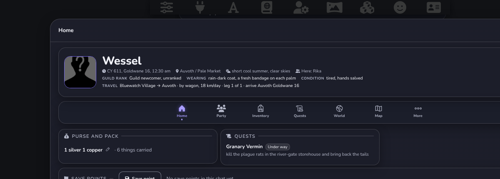
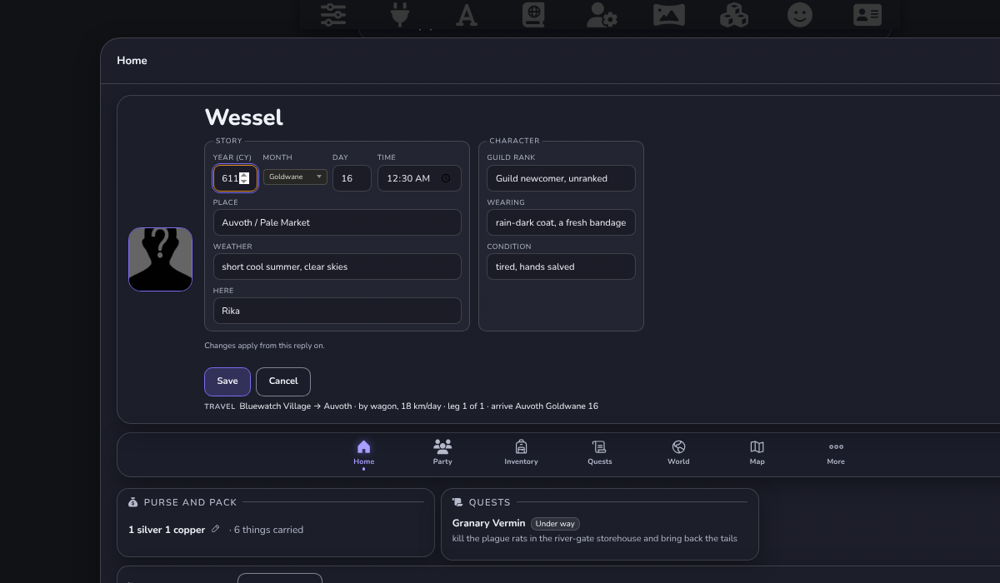
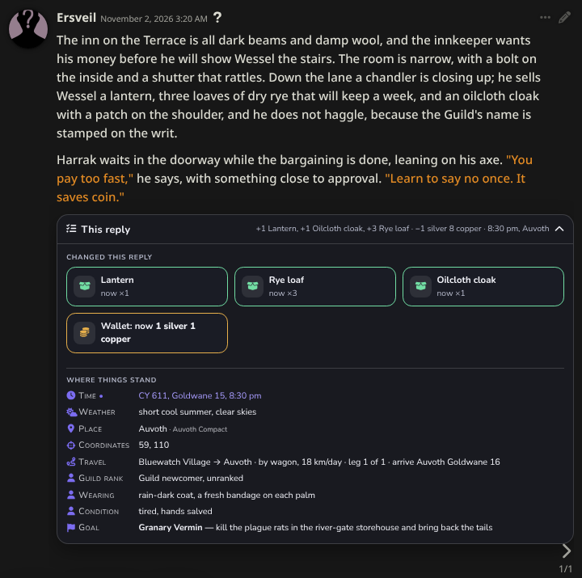
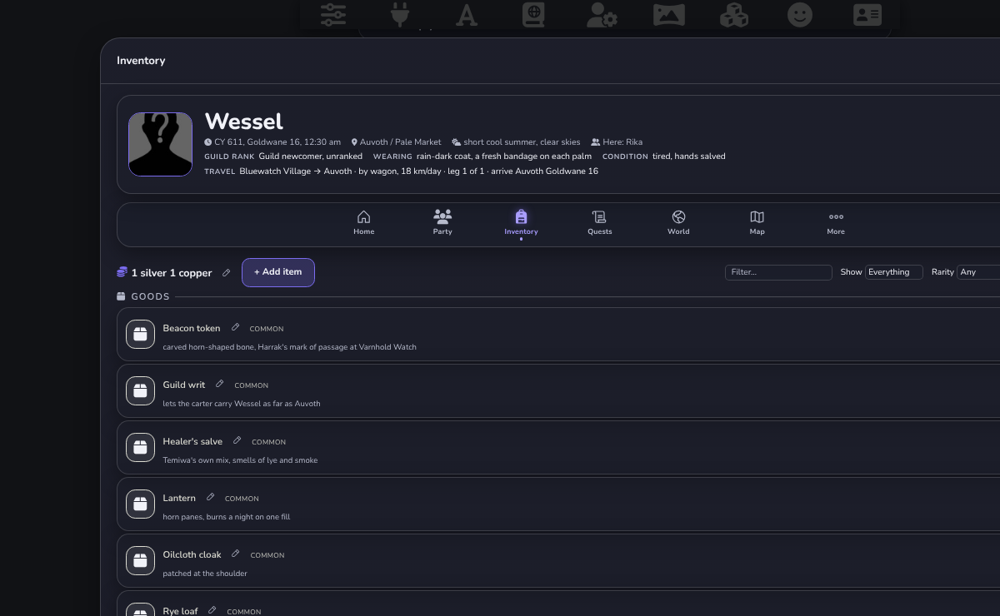
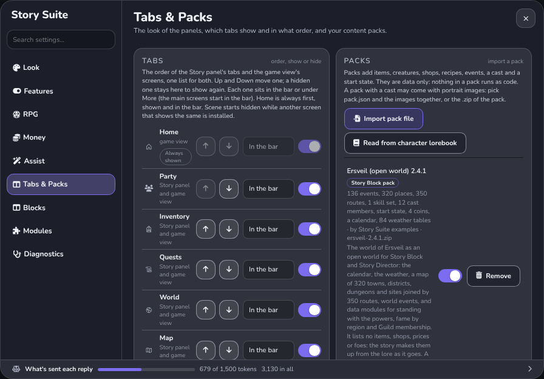
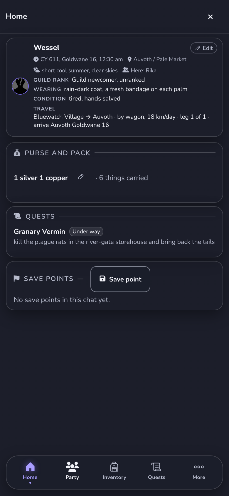

# Story Block 2.16.1

Story Block is a SillyTavern extension for stories with a narrator. It keeps your inventory, your purse, the place you are in and who is with you. The narrator writes what changed at the end of each reply. Story Block checks those lines, keeps the result with the reply and shows it to you in plain words.

*Home shows where you are, when it is, who is with you, and what you carry.*

For AI assistants that read this repository, see [AI-README.md](AI-README.md).

## Install

1. In SillyTavern, open **Extensions → Install extension** and paste `https://github.com/kohz87/Story_block`. Install this first.
2. Optional: install [Story Director](https://github.com/kohz87/Story_director) (clock, quests, map, World). It needs Story Block.
3. Optional: install [NPC State Delta](https://github.com/kohz87/npc_state_delta) (a dossier for each person you meet).
4. Reload SillyTavern. When you update, update Story Block before the others.

Story Block is built and tested on SillyTavern 1.19. [Story Studio](https://github.com/kohz87/Story_studio) is not an extension: it is one page you open in a browser to write packs.

To try a world, import the Ersveil example pack. Open **Settings → Tabs & Packs → Import pack file** and pick [`examples/packs/ersveil/pack.json`](examples/packs/ersveil/pack.json) together with the pictures in [`examples/packs/ersveil/portraits/`](examples/packs/ersveil/portraits). Then start a new chat. Ersveil needs Story Director. [Ersveil](docs/v2/ERSVEIL.md) explains the world.

## What you see and do

**The Game view.** Open it with the **Game view** button above the message box, or with Alt+G. At the top is you: your name, the story's date and time, the place, the weather and who is here. Under it is a bar of screens. Home and Inventory sit in the bar, with Quests, World and Map when Story Director is installed. Everything else is under **More**. You choose which screens are in the bar in **Settings → Tabs & Packs**. The **Story** button opens the same screens as a panel beside the chat.

**The Edit button.** Press **Edit** in the header to change the story yourself: the date and time (with Story Director), the place, the weather and who is here. Under **Character** you can set your rank (when the world has one), what you wear and your condition. Press **Save** and the change applies from the latest reply on. **Cancel** or Escape leaves everything as it was. A date the calendar does not have is refused, and nothing else is saved until you fix it.

*Edit the story clock, place and your look yourself; changes apply from the next reply.*

**The reply card.** Under each reply is a card called **This reply**. Closed, it is one line. Open, it says what the reply changed: items gained or lost, the wallet, the place, who came or left. Other parts add their own sections to it, such as the time and your goal. A line Story Block could not use shows as "not applied" with the reason. If you edit a reply, press **Re-read** and Story Block reads its change lines again. If you swipe or delete a reply, its changes are taken back.

*Every reply carries a card that says what the story changed, in plain words.*

**Inventory and purse.** The Inventory screen lists what you carry by kind, with a filter, equip and drop. Press **+ Add item** to add something yourself. The pencil beside an item or the purse edits it. Your edits ride on the latest reply, so a swipe takes them back too. The story can also lay out loot; tick what you take and press **Take selected**. Mounts (horses, carts) get their own card on Home while you have one.

*Inventory keeps what the story gives you and takes from you.*

**Save points.** On Home, **Save point** keeps this moment as a named branch of the chat. **Return here** opens that branch. **Forget** takes it off the list; the branch itself stays in SillyTavern.

**Packs, portraits, cast and dossiers.** A pack is a data file for a world: places, routes, a calendar, weather, events, coins, a starting state and, if it has one, a cast of people. A pack never runs code. Install one in **Settings → Tabs & Packs**. A cast can have portrait pictures: pick them together with the pack, or pick one `.zip` made by Story Studio. Story Director brings the cast into the story, and NPC State Delta gives each person a dossier when you meet them. World and the dossiers are those parts' screens; they appear when the parts are installed.

*Install a pack (a .json with its pictures, or one .zip) and switch it on or off here.*

**On a phone.** The Game view is one column and the bar sits at the bottom.

*The same Home on a phone.*

**RPG (off by default).** **Settings → Features → RPG** adds a party sheet, automatic dice and a battle log. See the [RPG guide](docs/v2/RPG.md). RPG Battle, the old separate extension, is no longer supported and its rules packs cannot be imported.

## Settings worth knowing

Open them with the **Suite** button above the message box or from the wand menu (**Story Suite**). The window opens on Features.

- **Features.** Pick **Lean**, **Standard** or **Full** to say how much the story tracks. Each says what it tracks and how many tokens of rules the narrator reads. Switch single parts on or off below. Choices and Inner chatter are off by default.
- **Look.** Panel style, glass strength, font and **Text size** (Normal, 110% or 120%). Text size changes Story Suite's own text; SillyTavern's chat text keeps its size.
- **Money.** Your world's coins and money words. The story decides how much a reply gives; there is no per-reply cap.
- **Assist.** Two optional helpers that each make one extra, cheap model call. One reads change lines the reply forgot. One rolls a check before the reply (it needs a part that keeps checks, such as Story Director). Both are off by default.
- **Tabs & Packs.** Which screens are in the bar, your packs, and the budgets under **Prompt** (notes per reply, share of the context, change lines per reply). **What's sent each reply** shows the exact text.
- **Blocks.** Small trackers you make for one story. Choose where each shows: its own tab, a card on Home, both, or hidden.
- **Diagnostics.** A report you can copy when something goes wrong.

## How the four fit together

The Story Suite has four parts.

- **Story Block** (2.16.1) is the hub. It keeps the story's state, runs the packs and draws the reader's screens.
- **Story Director** (2.9.1) adds the story clock, the map, quests, the world's events and the pack's living cast. It needs Story Block.
- **NPC State Delta** (1.7.1) adds a dossier for each person you meet, with meters, stages and secrets. It needs Story Block; with Story Director it also follows the cast and Key people.
- **Story Studio** (0.6.0) is a separate page where you write packs. It is not an extension.

Install Story Block first, then Story Director, then NPC State Delta if you want it. Data flows one way: you write a pack in Studio and import it in Story Block; Story Director reads what Story Block holds, and NPC State Delta reads both. Nothing flows back to Studio.

## Limits

- One currency per chat, with up to eight coins.
- A reply may hold up to 150 change lines (you can change this). Lines past that are not used.
- A chat can have up to eight blocks. The party can have up to six mounts.
- A pack file is at most 512 KB. A cast portrait is stored at 150 KB or less; a bigger picture is made smaller when you import it.
- Story Block makes extra model calls only for the helpers you turn on (Assist, RPG rolls).
- SillyTavern's Data Maid lists a pack's portraits as unused files. Do not delete them there.

## Troubleshooting

- **Changes at the end of a long reply are missing.** The reply may have hit SillyTavern's response length setting before the narrator finished the change lines. A half-written last line is never used; the reply's card says so. Raise the response length, or press Continue, then Re-read if you edit the reply.
- **A reply has more change lines than the limit.** Raise **Change lines per reply** under Tabs & Packs → Prompt.
- **The card says "No change lines came with this reply".** Nothing changed, or the narrator forgot. Edit the reply to add a `<Changes>` block and press **Re-read**.
- **A chat that was stuck heals when you open it.** If a chat refused every reply with "A native change is finishing", update Story Block (2.16.1) and NPC State Delta (1.7.1), open the chat and send again.
- **A pack will not import.** The message names the reason. A pack may need a newer Story Block or another part, such as Story Director for Ersveil.
- **A new pack has no effect in a running chat.** A chat keeps the pack it began with. Start a new chat to use a pack's starting place and inventory.
- **Your context size is too small.** Raise SillyTavern's context size or turn features off (Features → Lean).
- **To continue a chat without Story Block**, follow "Removing Story Block from a chat" in the [guide](docs/v2/GUIDE.md).

## More

[Player guide](docs/v2/GUIDE.md) · [RPG guide](docs/v2/RPG.md) · [Pack guide](docs/v2/PACKS.md) · [Authoring kit](authoring-kit/README.md) · [Changelog](CHANGELOG.md) · [Licence](LICENSE) (AGPL-3.0). Icons include [Phosphor Icons](ICONS-CREDITS.md). Report bugs in [Issues](https://github.com/kohz87/Story_block/issues).
